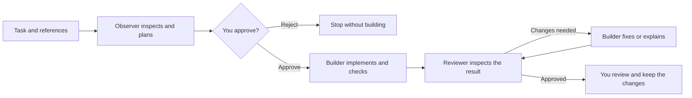

<div align="center">
  
  <h1>Relay</h1>
  <p><strong>Your agents. One shared workflow. You approve the changes.</strong></p>
  <p>A local workspace for Claude Code and Codex to inspect, plan, build, and review software together.</p>
</div>

Relay coordinates your installed coding agents through a browser dashboard. Give them a task, attach a screenshot, choose their responsibilities, and review their proposed plan before implementation starts.

Use it for frontend work, backend changes, project observations, or implementation planning. Relay runs on your computer and uses your existing command-line tool sign-ins.

> **Early prototype · macOS first.** Automated tests and scripted browser checks cover the coordinator and its interfaces. A real Claude observation has been verified; a complete live multi-provider build/review cycle and live image understanding have not yet been verified in the development environment.

## What you can do

- **Inspect without editing.** Get an observation or a plan from the current files, including uncommitted changes.
- **Choose your team.** Assign Claude Code or Codex to each role, select models and effort, add instructions, and save presets.
- **Clarify before approving.** The Observer asks focused questions when key requirements are missing. Your answers refine the plan and never authorize edits.
- **Approve before building.** Review the proposed plan, risks, and verification checks before the Builder starts.
- **Bring visual context.** Pick, drop, or paste screenshots and reference images into tasks and follow-ups.
- **Continue the conversation.** Ask read-only follow-up questions in the same saved chat.
- **Act on findings.** Select issues and turn them into an editable planning or implementation brief with evidence attached.
- **Review the result.** Read an overview, priority labels, next actions, file-by-file diffs, new-file previews, and Builder-reported checks.
- **Recover saved work.** Retry a failed step or explicitly continue interrupted work in the same working copy, preserving completed results and approval records.
- **Keep local history.** Search chats, reopen reports, or move conversations to recoverable local Trash.

The dashboard opens with no conversation selected. Saved chats stay in the sidebar until you choose one.

## Requirements

| Requirement | Details |
| --- | --- |
| Python | Python 3.10 or newer |
| Git | Required for build tasks and the repository-based test suite |
| Agent tools | Claude Code, Codex CLI, or both, installed and signed in for the roles you choose |
| Operating system | macOS is the primary environment. The backend requires POSIX process groups and file locking; Linux is not yet validated and Windows is unsupported. |
| Optional development tools | Node.js 18+ and npm for the convenience scripts and frontend checks |

The backend uses Python's standard library. **No `pip install` or `npm install` is required.**

The default team uses Claude as Observer and Reviewer, and Codex as Builder. You can assign the same provider to all three roles. Only the providers needed by the selected task mode must be ready.

## Quick start

Download or clone this repository, then open a terminal **inside the Relay folder**.

Sign in to the tools you will use:

```sh
claude auth login
codex login
```

Skip the command for any provider you have not installed or do not plan to use. Start Relay:

```sh
python3 server.py --open
```

The dashboard opens at [http://127.0.0.1:8765](http://127.0.0.1:8765). Keep the terminal running; press **Control+C** to stop the server. On macOS, you can also double-click `Start.command`.

If you use npm, `npm start` launches the same normal server.

### Connect your own accounts

Relay uses the authentication already configured in your installed CLIs. It does not provide shared accounts, ask you to upload credentials, or require a separate Relay API key. Model access, provider configuration, billing, and usage limits remain those of your tools and accounts.

In the dashboard, open **Agent connections** to check installation and sign-in status. A successful connection check does not guarantee a model request will succeed. Relay has no combined spending or token cap.

If an executable is not found, set its path before starting Relay:

```sh
export RELAY_CLAUDE="/absolute/path/to/claude"
export RELAY_CODEX="/absolute/path/to/codex"
python3 server.py --open
```

Relay also checks known macOS installation locations. For another port:

```sh
python3 server.py --port 8766 --open
```

Only one server may use a Relay data folder at a time, even if the ports differ.

## Choose a task mode

| Mode | What runs | Editing | Project requirement |
| --- | --- | --- | --- |
| **Observe only** | Observer inspects and reports current behavior, risks, and findings | Disabled | Any existing folder |
| **Plan only** | Observer proposes steps, affected files, risks, and verification criteria | Disabled | Any existing folder |
| **Build & review** | Observer → clarification if needed → your approval → Builder → Reviewer → fix/review rounds as needed | Builder only, after approval | Clean Git repository with at least one commit, selected at its root |

Read-only modes inspect your selected folder directly. They can see staged, unstaged, and untracked files without requiring a commit or stash. They do not treat those existing edits as changes made by an agent.

Build tasks create a separate detached Git worktree from committed `HEAD`. Your original checkout's source files stay unchanged. Untracked and ignored files, local dependencies, and uncommitted edits are not copied; submodules are not initialized automatically.

## Start your first task

1. Choose **Add project**, give it a name, select its folder, and save it.
2. Select the project and task mode.
3. Describe the desired result and any acceptance criteria. Attach visual references if useful.
4. Open **Configure team** to choose tools, models, effort, and role instructions.
5. Set the time limit and, for builds, the review-round limit. Start the task.
6. For **Build & review**, inspect the proposed plan and approve or reject it.
7. Read the final report and review any file changes before keeping them.

**Remove** in the project selector forgets the saved entry; it does not delete the folder.

**Watch an example** runs a clearly labeled simulation. It does not call agents, spend model usage, or change a project.

## How collaboration works



| Role | Responsibility |
| --- | --- |
| **Observer** | Inspect source and visual references; identify findings and propose a plan. |
| **Builder** | Implement the approved task, run appropriate checks, and report outcomes or blockers. Handles frontend and backend work. |
| **Reviewer** | Inspect the actual result against the task and acceptance checks; approve it or request evidence-backed fixes. |
| **You** | Define the task, approve the plan, inspect the result, and decide whether to keep it. |

### Clarify missing details

For **Plan only** and **Build & review**, the Observer can ask up to five focused questions at a time when important requirements are unclear. Clear tasks go straight to a plan. Questions appear in **A few details before the plan**, with optional suggested answers and a text field for your own answer.

Answer every question and choose **Send answers & update plan**. Relay sends the answers to the read-only Observer, which revises the plan or asks remaining questions. The task timer pauses while waiting for answers. Stop remains available.

**Sending answers never approves edits.** A build still stops at **Awaiting your approval** with the final revised plan. Plan-only tasks finish with a read-only report. Observe-only tasks and report follow-ups keep their existing read-only report behavior.

Questions and submitted answers stay in the chat under **Your clarification answers**, are preserved in follow-ups, and are included in the Builder and Reviewer handoffs. Unsent text is saved in this browser tab's session storage, so you can reload and reopen the waiting chat. A server restart interrupts the task; it does not resume questions or approve work automatically.

### Approval before editing

Every real build task waits at **Awaiting your approval** after observation and any clarification rounds. **Approve & start building** releases the Builder; **Reject plan** stops the task without starting it. Approval covers the proposed implementation and its configured review/fix rounds.

The task's time limit pauses while waiting for this decision. Refreshing the browser preserves the pending plan. Graceful shutdown stops the task and saves its changes. After a crash or forced termination, restart marks unfinished tasks interrupted. Neither path approves or resumes work automatically.

Read-only tasks and follow-ups do not start a Builder and do not require this approval gate.

### Team presets, models, and effort

Each role stores its provider, model, effort, and additional instructions. **Tool default** leaves the corresponding setting to the installed CLI. The model and effort menus show Relay's configured choices; Codex can also use its visible local model cache. Availability still depends on your installed tool, provider settings, and account.

Use **Save preset** to store a named team and **Use team** to apply the current settings. New tasks save their own team configuration; changing a preset does not rewrite existing tasks. Follow-ups inherit the conversation's Observer settings. Additional instructions do not grant extra tools or editing permissions.

Adding another AI provider requires a new adapter and compatibility tests; the current integrations are Claude Code and Codex CLI.

## Images and screenshots

Use **Attach images**, drop files onto the attachment area or prompt, or paste an image into the prompt. Thumbnails show the selected images, with a Remove button for each one.

- Supported formats: **PNG, JPEG, WebP**. Convert HEIC files first.
- Limits: **four images**, including inherited references, at **4 MB per image**.
- Images are saved with the chat when you send the task, outside your project files.
- Each assigned role receives the references when its provider runs.
- Follow-ups inherit saved images; findings-based tasks copy them into the new task.
- Unsent selections stay in browser memory. Reselect them after a manual page reload.

Starting a real task sends its images, prompts, and relevant project context to the configured agent providers. Image support and usage limits depend on the selected model and tool.

## Read reports and continue the conversation

The conversation shows a compact progress state while agents work and the final result when they finish. Individual tool calls and intermediate messages remain in local logs.

New structured reports include:

- A short overview.
- Findings labeled **Critical**, **High**, **Medium**, or **Low** by the agent.
- Recommended next actions.
- An expandable **Full report & evidence** section with Markdown formatting.

Older reports remain readable. Missing priority ratings are labeled **Unrated** rather than generated afterward.

### Ask a follow-up

Use **Continue this conversation** below a completed real report. Relay sends the prior questions and reports as context and runs the configured Observer with editing disabled. Answers stay in the same chat, with earlier reports and build changes preserved.

Each answer uses a fresh CLI invocation; this is not a resumed desktop-app session. Very long conversations are rejected with a request for a focused new task instead of silently dropping context.

### Turn findings into a task

Open **Review findings**, select the issues to address, then choose **Plan selected** or **Build & review selected**.

Relay opens an editable draft with the original project, team, selected evidence, and image references. Review it before pressing Start. A build still requires a clean repository and waits for plan approval. Changing the project or choosing **Clear** removes the attached finding context.

## Review and keep code changes

The **Changes** tab provides:

- File navigation with modified, added, deleted, and new-file labels.
- Line-numbered diffs with additions and deletions highlighted.
- Saved previews of new text files.
- The latest round's **Builder-reported checks**, distinguished as passed, failed, or not run.
- Expandable Builder reports from earlier rounds.

**Reported checks are claims from the Builder, not tests independently rerun by Relay.** The Reviewer inspects source evidence; it does not serve as a separate test runner. A completed task does not establish that every check passed.

Previews are bounded and show notices for truncation, binary files, and unavailable content. Older tasks without saved per-file previews use their existing patch where possible; their new-file bodies may be unavailable. New build snapshots save a complete `changes.patch`, including added, modified, deleted, and binary files, symlinks, and executable permissions. Ignored files are excluded. Generating the patch does not change the working copy’s Git staging area. Older patches may omit new files and are not offered as complete downloads.

After the task finishes, choose **Download complete patch** in **Changes**. In a clean checkout of the same starting commit, run `git apply --check /path/to/relay-<chat-id>.patch`, then `git apply /path/to/relay-<chat-id>.patch`, and rerun your checks. This also preserves new files. You can instead open the displayed working copy, inspect the changes, create a branch there, and commit through your normal Git workflow. **Relay does not automatically merge, commit, or push the result.** Keep any worktrees you still need; remove them using Git's worktree tools when appropriate.

## Recover a failed or interrupted task

For tasks created with checkpoint support, a **Recover this task** or **Continue interrupted work** panel shows what is saved and which step comes next. Choose the action shown there:

- **Retry review** reruns only the Reviewer against the preserved working copy and saved Builder report. It does not repeat observation or building.
- **Continue build** keeps partial edits, asks the Builder to inspect what already exists, and continues the same round.
- **Return to plan approval** reopens the saved plan for an explicit decision. An unapproved plan stays unapproved.
- **Continue questions** preserves the pending question batch and previous answers; answers still do not authorize edits.
- **Retry observation / plan update** repeats only the failed read-only stage.

Relay checks that the task folder and working copy still exist and that a build's original commit and repository identity are unchanged. It does not reset, recreate, merge, or commit the working copy. A saved completed review can be reused only if its source fingerprint still matches; changed files require another review.

Each recovery attempt gets a fresh time budget using the task's configured limit. The original review-round cap remains in force. Only one task can run, and a recovery cannot start while a previous worker is finishing its saves. **Recovery history** keeps previous errors and attempt outcomes. Provider prompts/results from retries have distinct attempt filenames.

Recovery is always explicit. Restart never starts agents or approves a plan on its own. A rejected plan cannot be resumed, and reaching the review-round limit does not grant more rounds. Older tasks and setup failures without a checkpoint need a new task; their working copies remain available for manual inspection.

A checkpoint records results only after Relay receives them. If a process crashes before a result is saved, that unsaved step may need to run again. Existing files remain available; recovery is a fresh CLI invocation with saved context, not a restored provider session.

## Controls and history

| Control or action | Behavior |
| --- | --- |
| **Pause handoffs** | Finish the current step, then wait before the next handoff. The task deadline continues. |
| **Stop** | Stop the current process group and prevent later handoffs. Written changes remain available. |
| **Without limit — rounds** | Continue fix/review rounds until approval, failure, Stop, or a configured deadline. |
| **Without limit — time** | Remove Relay's deadline; a configured round limit still applies. |
| Close the browser | Leave the coordinator running in its terminal. |
| Stop/restart the server | Control+C and SIGTERM stop the agent group and wait for task persistence. After a crash, unfinished tasks become interrupted. No automatic resume. |

Unlimited settings do not bypass provider quotas, authentication failures, machine sleep, or process failures. Only one task runs at a time.

Search saved conversations in the sidebar. On smaller screens, use **History** to open the list. **New task** clears the selected conversation and returns to the brief.

### Delete and restore a chat

Open a chat's **…** menu and choose **Delete chat**, or use that button in a finished chat's activity panel. Running tasks must be stopped first.

Relay moves the chat, its attachments, prompts, and logs into local Trash. The original project and task worktree remain intact. **Undo** restores the deleted chat while its notification is visible (ten seconds, paused while hovered or focused). Use the close button to dismiss it. Successful restoration feedback disappears after four seconds. Errors remain until dismissed or replaced. This does not erase the CLIs' own histories or permanently remove local data.

To restore an older chat manually, stop Relay, move its folder from `data/trash/<chat-id>/` back to `data/runs/<chat-id>/`, and restart.

## Local data and privacy

| Path | Contents |
| --- | --- |
| `data/projects.json` | Saved project names and local folder paths |
| `data/teams.json` | Saved team presets |
| `data/runs/<chat-id>/state.json` | Conversation turns, status, checkpoints, recovery attempts, reports, findings, approval records, checks, and saved change previews |
| `data/runs/<chat-id>/attachments/` | Images attached to that chat |
| `data/runs/<chat-id>/events.jsonl` | Readable activity log |
| `data/runs/<chat-id>/provider-events.jsonl` | Captured provider output and diagnostics |
| `data/runs/<chat-id>/*.prompt.txt` | Agent instructions and handoffs |
| `data/runs/<chat-id>/builder-*.txt` | Builder implementation reports |
| `data/runs/<chat-id>/changes.patch` | Tracked-file patch |
| `data/workspaces/<task-id>/` | Separate build worktrees |
| `data/trash/<chat-id>/` | Recoverable deleted conversations |

Relay's combined history is local. The installed tools may save their own sessions, but Relay does not sync a combined conversation into the Claude or Codex desktop apps.

Runtime data is not encrypted by Relay. The supplied `.gitignore` excludes `data/`, environment files, and generated caches. Do not force-add private logs or workspaces to a public repository; ignore rules do not remove files already tracked by Git.

Avoid moving Relay while a task runs. Existing worktrees and saved records can contain absolute paths, so moving the application after creating tasks may require Git worktree repair and path updates.

### Security boundaries

Relay is a single-user local application. It binds to loopback, validates request hosts/origins, and requires a per-process token for mutations. These controls are not user authentication. Keep the server local and use trusted projects.

Observer and Reviewer roles use read-only tools. Codex uses its read-only sandbox for those roles and workspace-write for the Builder. Claude read roles receive Read, Glob, and Grep; its Builder additionally receives Edit, Write, and Bash. Claude's restricted tool configuration is not an OS sandbox equivalent to Codex's.

Relay supplies no permission-bypass flags. Instructions against deployment, publishing, or pushing are not an independently enforced shell-command policy. Project instructions, dependencies, tool configuration, and agent behavior remain part of the trust boundary.

## Development

For automatic reload:

```sh
python3 dev.py --open
```

Or, with npm:

```sh
npm run dev -- --open
```

Python source changes restart the backend after a short debounce. Static asset changes refresh the browser. Reloads wait while a task is active; browser reload also waits while unsent image selections exist. Draft text, mode, limits, and selected chat are retained across automatic refresh; unsaved dialog edits are not.

Stop an existing normal server before switching to development mode. Keep the terminal open and press Control+C to stop it. Changes to `dev.py` itself require restarting the development command.

Run the tests:

```sh
python3 -m unittest discover -s tests -v
# Equivalent convenience command:
npm test
```

Optional frontend syntax checks:

```sh
node --check static/app.js
# Also check any changed module under static/js/
node --check static/markdown.js
node --check static/review.js
```

The tests use temporary files/repositories and fake provider processes rather than paid model calls. Node-based renderer tests are skipped if Node.js is unavailable. They cover workflow behavior, plan approval, read-only modes, persistence, image inputs, diff capture, Markdown escaping, and HTTP protections; they do not establish full live-provider compatibility.

Relay uses Python's `ThreadingHTTPServer`, not ASGI. `uvicorn server:app --reload` is not supported.

### Project structure

```text
server.py                 CLI launcher; composes and starts the backend
dev.py                    Development reload supervisor
static/app.js             Frontend startup and feature wiring
static/js/                Notifications, history, projects, teams, attachments, tasks, and shared helpers
static/                   Report renderers, styles, HTML, and icons
relay/                    Backend modules and application composition
tests/                    Workflow, HTTP, development, and rendering tests
docs/ARCHITECTURE.md       Architecture and implementation details
CONTRIBUTING.md           Contribution and verification guide
Start.command             macOS launcher
package.json              Optional npm convenience scripts
data/                     Private runtime data; ignored by Git
```

See [Architecture](docs/ARCHITECTURE.md) for implementation details and [Contributing](CONTRIBUTING.md) before proposing changes.

## Troubleshooting

| Problem | What to do |
| --- | --- |
| Python cannot find `server.py` | Open a terminal inside the Relay folder, or pass the script's full path. |
| Agent needs sign-in | Run the relevant login command, then **Refresh connections**. |
| Requested model fails | Check the installed CLI's supported models, configuration, and account access; try **Tool default**. |
| Build rejects a project | Select the repository root and commit or stash pending changes. Read-only modes do not require this. |
| Codex cannot start inside another agent's sandbox | Launch Relay yourself from Terminal or `Start.command`. |
| Relay is already running | Use the existing server or stop its terminal process. Changing ports does not bypass the data-folder lock. |
| Port is occupied | Choose another port with `--port 8766`. |
| Build appears to be waiting | Open the chat: the Observer may need answers, or the final plan may be awaiting approval. |
| Updated interface behaves incorrectly | Restart a normal server after backend changes and refresh the page, or use development mode. |
| Photo is rejected | Use PNG, JPEG, or WebP under 4 MB; convert HEIC first. Inherited images count toward the four-image limit. |
| Task was interrupted | Open it and use the recovery action when available. Otherwise inspect the preserved working copy and start a new task. Nothing resumes automatically. |

## Current limits and next steps

- No automatic recovery, provider-session resumption, or checkpoint migration for legacy tasks.
- No independent Verifier role or enforced browser visual check for frontend work.
- No automatic merge, provider quota tracking, or combined spending cap.
- No incremental history loading, disk quota, or permanent Trash purge interface.
- No hosted multi-user deployment or Windows support.

Before a stable release, verify complete live workflows with supported provider versions, including images, and record the environment and results.

## License

A distribution license has not been selected, and no `LICENSE` file is included yet.

## Integration references

- [Codex non-interactive mode](https://learn.chatgpt.com/docs/non-interactive-mode)
- [Codex image inputs](https://learn.chatgpt.com/docs/image-inputs?surface=cli)
- [Claude Code programmatic usage](https://code.claude.com/docs/en/headless)
- [Claude image input through streaming messages](https://code.claude.com/docs/en/agent-sdk/streaming-vs-single-mode)
