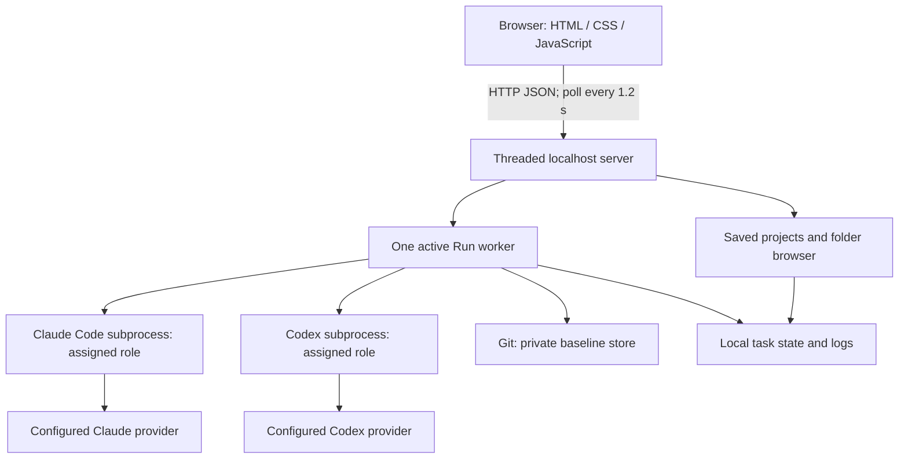
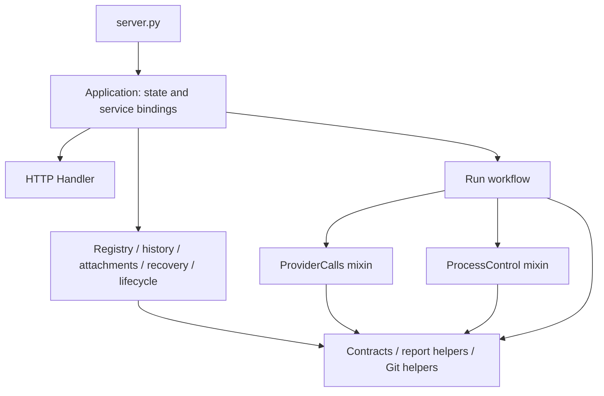

# Architecture

This document describes the implementation that exists today. Relay is a small single-process application, not a distributed agent platform.

## System boundary



The browser does not connect to model APIs directly. Python launches the installed CLIs and receives newline-delimited JSON output. The CLIs handle provider authentication, requests, account limits, and their own session persistence.

## Source layout and responsibilities

| File | Responsibility |
| --- | --- |
| `dev.py` | Development supervisor; watches Python app files, defers restart while busy, and starts server with `RELAY_DEV=1` |
| `package.json` | Dependency-free npm entry points for dev, start, and tests |
| `server.py` | Small CLI launcher; constructs the default application and calls its lifecycle entry point |
| `relay/application.py` | Composition root; owns per-instance runtime state and binds service functions, Run, and Handler |
| `relay/contracts.py` | Shared report schema, role/mode constants, image limits, and cancellation exception |
| `relay/http.py` | Local HTTP routes, Host/token/Origin checks, and allowlisted static responses |
| `relay/workflow.py` | Run state machine, plan approval, clarification, checkpoints, snapshots, and review rounds |
| `relay/processes.py` | Run process-control mixin: subprocess groups, stream draining, event decoding, and cancellation |
| `relay/providers.py` | CLI discovery, model/team validation, restricted commands, and Run provider-call mixin |
| `relay/git_ops.py` | Git inspection, bounded file previews, repository identity, and complete patch generation |
| `relay/reports.py` | Report/question validation, check parsing, metadata, follow-up context, and timestamps |
| `relay/attachments.py` | Image decoding and task-scoped saved attachment access |
| `relay/registry.py` | Project and team preset persistence, plus folder browsing |
| `relay/history.py` | Startup record loading, report lookup, state snapshots, and Trash/restore |
| `relay/recovery.py` | Recovery eligibility, approval/workspace validation, and explicit worker admission |
| `relay/lifecycle.py` | Startup, instance lock, dev revision, signal handling, and graceful shutdown |
| `static/markdown.js` | Escaping-first Markdown subset renderer; raw HTML and non-HTTP(S) links disabled |
| `static/report.css` | Final report document typography, code blocks, and tables |
| `static/index.html` | Forms, saved-project dialogs, workflow controls, and task panels |
| `static/app.js` | API calls, polling, project selection, and DOM rendering |
| `static/sidebar.css` | Conversation navigation, search list, day groups, and action-menu styles |
| `static/style.css` | Layout, responsive styles, focus states, and dialogs |
| `static/relay.svg`, icon assets | Branding and browser icons |
| `tests/test_relay.py` | Standard-library unit and local HTTP tests |
| `Start.command` | macOS launcher; resolves its own directory and runs Python |
| `data/` | Private runtime data; excluded from Git |

The backend is a dependency-free Python package. `server.py` remains the public launcher, so `python3 server.py --open`, npm scripts, and `Start.command` keep their existing behavior. Static files and private `data/` remain at the project root. Saved records and checkpoints use the existing formats; no migration is required.

## Composition and dependency rules



`Application(root, data=None)` owns `ROOT`, `DATA`, `TOKEN`, `LOCK`, `RUNS`, `ACTIVE`, and `SHUTTING_DOWN`. Construction allocates in-memory state only; it does not create storage, open a server, or call an agent. Independent application instances have separate registries, tokens, locks, shutdown events, and bound Run/Handler classes. The standard launcher creates one application.

Stateful service functions accept `app` explicitly as their first argument. The composition root binds them as application methods; the Handler, Run, and recovery admission code call those methods to share the same context. Stateless helpers remain ordinary functions, exposed as static application methods when needed by the orchestration layer. Services never import `server.py` or a default application singleton. Application-level dependencies can be replaced in tests without changing another application's bindings.

`Run` inherits two focused implementation mixins. `ProcessControl` owns launch/stop and stream handling; `ProviderCalls` owns Claude/Codex request and response adaptation. Both operate on the owning Run's process fields, task folder, role, and injected `app`; neither maintains its own registry or starts a separate workflow. `Run.run_role` retains the mode and plan-approval gates before either adapter is dispatched.

The application is the composition boundary, not a second workflow implementation. Add behavior to the owning module, then expose only the service needed by another boundary through `application.py`. Shared contracts cannot depend on HTTP, workflow, or persistence. Modules with pure helpers may import lower-level helpers directly. Stateful cross-service calls go through the supplied application to avoid circular imports and duplicate state.

### Extending the backend

- For a route, update `http.py`; keep workflow and persistence logic in their owning services. Preserve request token, Host, and Origin validation.
- For a provider, update discovery/commands and adapters in `providers.py`, and event normalization in `processes.py` if its stream format differs. Keep capabilities in command construction and approval enforcement in the workflow.
- For a workflow stage, update `workflow.py` and its explicit recovery contract in `recovery.py`. Persist the checkpoint before releasing a waiting worker.
- For stored data or exports, use `registry.py`, `history.py`, `attachments.py`, or `git_ops.py` as appropriate. Preserve atomic replacement, path checks, and the existing task record format.

The development supervisor already watches package Python files recursively. Tests copy the complete `relay/` package into disposable application roots, verify a module edit triggers deferred restart, and exercise instance isolation alongside the existing workflow/HTTP/recovery checks.

## Workflow and contract

A `Run` owns its task metadata, cancellation event, handoff gate, process reference, and optional deadline.

1. Check installation and sign-in for providers used by the selected mode.
2. For Build & review, work in the project folder directly and, just before the Builder first runs, record a baseline of its files in a private Git store (`--git-dir` under the data folder, `--work-tree` the project). Diffs, the patch and the Reviewer fingerprint compare against it; no Git repository or clean tree is required. Observe only and Plan only use the existing folder directly, without Git checks or worktree creation.
3. Ask the observer to inspect source and return observation notes and acceptance checks.
4. Wait for explicit user approval of the Observer’s plan, then ask the builder to implement, or address the previous review's findings, and report checks.
5. Capture the tracked diff and untracked file list.
6. Ask the reviewer to inspect the actual files and return a structured review.
7. Finish on approval, repeat for changes, or stop on a limit or failure.

`mode` is validated and saved per task; omitted mode defaults to `build` for compatibility. For `observe` and `plan`, only the Observer runs with read tools against the current selected folder (including uncommitted files, or a non-Git folder). Final diff capture is skipped for these tasks, so pre-existing changes are not attributed to the agent. Its report, findings, and acceptance checks are saved before finishing (`observing → done`). Plan mode requests proposed implementation steps; Observe mode requests current behavior and findings. `run_role` rejects Builder or Reviewer dispatch for these modes.

Reviews contain `status`, `summary`, `findings`, and `acceptance_checks`. Each finding has `id`, `file`, `problem`, `evidence`, and `requested_change`. The CLI receives a JSON Schema; Python also checks the essential fields. An approved review cannot contain findings. A `needs_changes` review must provide actionable findings. This checks the response shape, not the correctness of its claims.

States follow:

```text
queued → preparing → observing → awaiting_approval → building → reviewing
                                      ↑         |
                                      |    needs_changes
                                      |         ↓
                                      └────── fixing → reviewing

reviewing → done                  when approved
reviewing → needs_attention       when the round limit is exhausted
any running stage → stopped      on cancellation
any running stage → failed       on an error or deadline
unfinished saved run → interrupted on server restart
```

Pause is a handoff gate, not a separate state or a suspended OS process. It permits the current step to finish and blocks the next stage, including finalization. Deadline checks continue. `0` means unlimited for either rounds or minutes; the two limits are independent. The simulation uses scripted messages and never invokes either CLI.

## Concurrency and lifecycle

- `ThreadingHTTPServer` serves browser requests; a daemon worker runs each accepted task.
- The in-process `ACTIVE` reference permits one non-terminal task at a time.
- A nonblocking POSIX file lock on `data/.instance.lock` prevents two coordinator instances from sharing runtime storage, even on different ports. The OS releases the lock when the process exits; the lock file may remain.
- `RLock` guards shared snapshots and file writes. This is not a database transaction system; some worker metadata updates occur between snapshots.
- Agent processes use separate process groups. Reader threads drain stdout and stderr into a queue while a writer thread sends the prompt over stdin.
- Stop requests set a cancellation event and signal the current process group, then attempt escalation. A per-run process lock serializes launch and cleanup; repeated cleanup is safe. Group permission errors after leader exit do not replace cancellation with failure, and direct signaling is attempted if the leader remains alive. Cleanup failures are recorded in task diagnostics. Detached processes that create their own session are not guaranteed to be terminated.
- Initial version/auth checks and synchronous Git operations have their own timeouts. Cancellation and the task deadline are observed at the next cooperative check, not a hard wall-clock kill at every instruction.

SIGINT and SIGTERM block new task admission, request cancellation, terminate the provider group, and wait up to 60 seconds for final snapshots before closing the server. A worker that cannot finish within that bound is saved as interrupted. The development supervisor forwards shutdown and allows this cleanup window. Restart after a crash preserves records and marks unfinished tasks interrupted. It does not recover a live provider session or start agents automatically. Explicit recovery can continue the saved state machine after validation.

## Persistence and history

Project saves and state snapshots use a temporary file and replacement. Readable events append to `events.jsonl` and are also included in `state.json`. Raw captured CLI lines append to `provider-events.jsonl`; prompts and final builder reports are separate files.

`state.json` is the dashboard snapshot, not a durable transaction journal. A crash can leave its last snapshot behind the appended event log. Startup does not replay events. Finished chats can be moved to `data/trash/<task-id>/` and restored. A worker completion event blocks deletion while its final writes are pending. Deletion preserves the Git worktree and does not affect provider-side histories. No disk quota, permanent Trash purge, encryption, or automatic worktree cleanup exists.

Tracked diffs use `git diff HEAD`. New files are listed separately for review and included in `changes.patch`. A temporary Git index reads HEAD and stages the final working tree only into that temporary index. The binary, full-index patch includes additions, deletions, modes and links without changing the real index. Ignored files are excluded. Large diff excerpts and builder reports are bounded in review prompts, and the reviewer is instructed to read the actual files. A history entry records results, not a reproducible proof that all checks succeeded.

Each step launches a fresh CLI session. Relay passes context explicitly through observations, findings, and builder reports. The coordinator does not resume a provider session or automatically combine CLI histories in desktop applications.

## HTTP surface

All routes require a recognized localhost Host header. Mutating POST requests require the per-process `X-Relay-Token`; an Origin header, if present, must match the local server. JSON bodies must be objects and are limited to 128,000 bytes to accommodate the task and three role-instruction fields.

| Method | Route | Purpose |
| --- | --- | --- |
| GET | `/` and named static assets | Dashboard and icons; assets are allowlisted |
| GET | `/api/state` | All stored task snapshots and browser mutation token |
| GET | `/api/export?run=<id>` | Download a saved complete patch for a finished task |
| GET | `/api/dev` | Dev-only revision and busy state; returns 404 outside dev mode |
| GET | `/api/models` | Provider model choices and effort metadata |
| GET | `/api/teams` | Built-in team and saved presets |
| POST | `/api/teams/save` | Validate and create/update a named preset |
| GET | `/api/connections` | CLI versions and sign-in checks |
| GET | `/api/projects` | Saved project entries and current folder existence |
| POST | `/api/projects/save` | Validate and save a name and folder |
| POST | `/api/projects/remove` | Remove an entry, preserving its files |
| POST | `/api/folders` | List visible subfolders of a local path; at most 500 entries |
| POST | `/api/history/delete`, `/api/history/restore` | Move a finished chat to local Trash, or restore it; worktree preserved |
| POST | `/api/run` | Validate options and create one task |
| POST | `/api/pause`, `/api/resume`, `/api/stop` | Control the specified active task |
| POST | `/api/recover` | Validate a saved checkpoint and explicitly continue the same task |

The folder API can navigate folders accessible to the server's OS user. It is not confined to saved projects. The token and local binding protect the browser interface from unrelated websites; they are not an authorization boundary against local processes or a multi-user identity system.

## Agent permissions and trust

Claude uses restricted mode, `dontAsk`, and an empty strict MCP configuration. Its read roles receive only read tools; its builder also receives Edit, Write, and Bash. Explicitly allowed Bash execution does not impose an OS sandbox equivalent to Codex. Codex uses `read-only` for observer/reviewer and `workspace-write` for builder, with normal installed configuration. No bypass flags are supplied.

Builds edit the project folder directly; the baseline records changes for review but is not a sandbox and does not roll anything back. Project content, dependency setup, Codex configuration, hooks, network access, and provider behavior remain trusted inputs. Publishing restrictions in prompts are instructions, not independently enforced command allowlists. Relay stores potentially private code in logs and sends relevant context to configured agent providers.

## Known design limits

1. **History cost grows with use.** Every activity event rewrites the full state snapshot, every poll returns every run with full event history, and the frontend rerenders the selected feed. Unlimited runs are supported logically but are not memory-, disk-, or bandwidth-bounded.
2. **Bounded recovery.** New tasks can continue explicit checkpoints in the existing working copy. Legacy histories and setup failures without checkpoints cannot be resumed. Provider sessions are not restored; a result lost before its checkpoint may require repeating that step.
3. **Provider coupling.** CLI flags and event formats may change. Current tests use fake processes; a real end-to-end compatibility check is required before a stable release.
4. **Review is not independent test execution.** Read roles inspect source; the assigned builder reports the checks it runs.
5. **Single-user POSIX scope.** No Windows process control, login system, hosted deployment, or concurrent task scheduling is implemented.
6. **Absolute paths.** Moving Relay or task worktrees can break saved metadata and Git worktree pointers.

## Recommended evolution

Extract modules when changing their respective responsibilities rather than performing a broad rewrite first:

```text
relay/
  workflow.py       # Run state machine and handoff policy
  providers.py      # Claude/Codex launch arguments and event decoding
  processes.py      # subprocess lifecycle, cancellation, deadlines
  storage.py        # projects, snapshots, and event persistence
  git_ops.py        # Baseline creation, diffs, and complete patch export
  http.py           # request validation and response routing
server.py           # small launcher
```

Before adding more agents or concurrent tasks, prioritize incremental event retrieval, broader live recovery verification, explicit check records, provider session IDs, and live integration tests. The module tree above is a proposal, not the current source layout.

## Configurable teams

Team profiles are implemented for observer, builder, and reviewer. Each role stores `provider` (`claude` or `codex`), an optional `model`, an optional `effort`, and additional `instructions`. `validate_team` normalizes and copies these values; `Run.info.team` snapshots them when a task is created. `data/teams.json` stores named presets, while the current browser selection is remembered in local storage. The built-in default is returned separately and is not overwritten by preset saves.

`Run.run_role` dispatches by the selected provider. `provider_command` constructs the provider-specific arguments and role-specific capabilities. The existing event parser still branches on the provider name; it presents consistent agent/role message, tool, review, and error events to the dashboard. Codex read roles use `--output-schema` and parse the final output file, separately from progress messages. Claude read roles use structured JSON output. Both return the same review contract.

Claude builders receive Edit, Write, and Bash in addition to read tools; Claude read roles do not. Codex builders use `workspace-write`; Codex read roles use `read-only`. Additional instructions do not change the selected capability set. Model selection is forwarded as a single `--model` argument. Effort becomes `--effort` for Claude and a `model_reasoning_effort` configuration override for Codex. Empty settings omit the override, and older presets are normalized to empty effort. `/api/models` returns Claude aliases and visible Codex cache entries (or fallback models) with supported effort menus; hidden/internal entries are excluded. The cache is metadata, not a live account entitlement check; supported model names and account access are checked by the provider during execution, not discovered by Relay.

Only providers assigned to the team must pass preflight checks. The same tool may fill all three roles, but stages remain sequential and only one builder is active. Existing histories without a team snapshot remain readable. The scripted simulation always uses the built-in example team and is not provider validation.

Adding another provider still needs a command adapter, event decoding, result normalization, cancellation checks, and compatibility tests. Merely adding a dropdown option is insufficient. Credentials should remain in the provider’s supported local sign-in/configuration flow.


## Development reload

`npm run dev` invokes `python3 dev.py`; Node is only a command runner and is not a backend dependency. The supervisor watches Python source changes, excluding private runtime data, tests, dependency directories, and itself. It starts the existing server with `RELAY_DEV=1`, debounces source changes, checks `/api/dev`, and defers restart until the task worker has finished. It sends SIGINT for normal cleanup before starting a replacement process. Direct Ctrl+C or SIGTERM stops the supervisor and child; it intentionally stops an active task too.

In development mode, `/api/state` includes revision/busy metadata. Revision combines a hash of static asset mtimes/sizes with the per-process token, so it changes on static edits or server restart. Browser polling reloads the page when revision changes and the server is idle, retaining task drafts in session storage. Static edits do not restart the backend. Outside development mode no automatic refresh is enabled. There is no ASGI/Uvicorn entry point.

## Report follow-ups and finding handoffs

`POST /api/followup` takes `source_id`, `task`, and optional `minutes`. It resolves a completed non-demo chat server-side, rejects a still-finalizing worker, forces `mode=observe`, and inherits the chat's Observer configuration. Prior questions and summaries become reference context. A new `Run` reuses the conversation id/folder and snapshots the prior turn into `info.turns`; `conversation_title` and `original_project` remain stable. The worker remains subject to the single-active-run lock. This is a fresh provider invocation, not provider-session resumption. Per-turn prompt and Codex result filenames avoid overwriting earlier artifacts. History deletion/restoration moves the complete conversation folder, including its saved turns.

`POST /api/run` can take `source_id` and `finding_indexes`. Indexes are validated against canonical saved findings; an empty/invalid selection is rejected. Only selected findings and their evidence enter the new task's context, and the project must match the source's original project. The frontend opens a draft first; it does not start work when findings are selected. A source snapshot is stored in `info.source`, and the context is saved in the task record. Context over 90,000 characters is rejected explicitly. A read-only follow-up without new findings leaves the most recent earlier findings available for handoff; earlier build diffs are displayed from the saved turn.

## Plan approval gate

Real build tasks call `wait_for_plan` after observation and enter `awaiting_approval`. `info.plan` snapshots the structured report with a generated plan id. A dedicated `approval_event` gates the first Builder invocation; `run_role` independently rejects Builder dispatch unless `approved_plan_id` matches the current plan. `/api/approve-plan` requires the normal request token/origin protections, the current live worker and waiting state, and the exact plan id. It persists the approval id and timestamp before releasing the event; stale and duplicate approvals are rejected. Pause/resume uses a separate event and cannot approve a plan. Stop interrupts the waiting worker. The deadline is suspended during the approval wait and shifted by elapsed waiting time afterward. Approval records are preserved in conversation turns when following up. Server restart retains the existing interrupted-task behavior; approval is never inferred on load.

## Change review and report summaries

Structured provider output now requests `overview`, `next_actions`, and a priority enum on each finding. `validate_review` accepts older reports without those fields but validates present values; the UI labels missing priorities Unrated and older summary text as an excerpt. The full report remains expandable. Metadata is preserved per conversation turn.

Build snapshots save `file_reviews`: per-file status, content, line counts, and preview notices. Git paths use NUL-separated output and rename detection is disabled for the per-file list. Tracked-file previews come from Git with external diff/text conversion disabled. New-file text reads are bounded, binary/invalid UTF-8 content is not rendered, and symlink or outside-workspace targets are not read. A 100,000 per-file/600,000 overall character budget bounds saved previews, with notices when content is omitted. `changes.patch` is atomically replaced by a complete binary patch; `export_complete` marks successful generation. The Changes panel offers a download only after completion. `GET /api/export?run=<id>` serves the saved patch for finished tasks (including an earlier build followed by read-only turns), rejects active or legacy incomplete exports, and rejects symlink paths. It never reads arbitrary project paths or regenerates old patches on download.

Each Builder round saves the complete report and extracts an optional fenced `relay-checks` JSON list. Only commands with passed/failed/not_run outcomes are shown as structured results; unsupported or malformed data never becomes an inferred passing check. `static/review.js` renders saved diff lines and report overview cards with escaping; `static/review.css` styles file navigation, diffs, priorities, and reported checks. No filesystem-read API is exposed by the viewer. Saved Builder reports and file reviews are included in conversation turn snapshots.

## Image attachments

`/api/run` and `/api/followup` accept `images: [{name, mime, data}]` where `data` is plain base64. Only those routes allow a 24 MiB request body; other mutation routes keep the 128,000-byte limit. Decoding validates base64, image header/MIME agreement, and 4 MiB per-image/4-image count limits before task construction. Header checks do not replace a full image decoder; corrupt content can still be rejected by the provider.

Saved bytes use generated hex ids and server-chosen extensions in the chat's `attachments/` directory. State includes metadata, never raw base64. Image reads reject invalid ids, symlinks, oversized saved files, and paths outside the chat. `/api/image?run=<id>&image=<id>` serves only a referenced image from a chat present in `RUNS`; there is no arbitrary local-path read endpoint. Standard loopback Host protections and image MIME/nosniff responses remain in effect. Images in Trash are unavailable through this route until restored.

Every role receives the saved reference set. Codex attaches paths via repeated `--image` flags with an explicit option terminator before the stdin prompt. Claude switches to `--input-format stream-json` only when images exist and sends one newline-terminated user message containing text and base64 image blocks. The launcher's optional `input_data` keeps the readable prompt separate from the multimodal input. No tool permissions or approval gates are expanded. Conversation turns preserve metadata; follow-ups retain images in place, while derived tasks copy image bytes to their own record.

The browser keeps unsent image data in memory, supports picker/drop/paste with bounded files, and clears accepted images only after a successful task request. Development reload defers while unsent images exist; manual reload discards them. The image-count limit includes inherited references. Tests cover request ingestion, native provider payloads, inheritance, path safety, and Trash/restore. Browser submission checks use scripted providers, not live models.


## Frontend features

The dashboard uses native browser ES modules and needs no bundler or package installation. `static/app.js` is the composition root: it creates the feature controllers, supplies their callbacks, registers handlers once, restores development drafts, and starts initial loading.

| File | Responsibility |
| --- | --- |
| `static/js/notifications.js` | Show, dismiss and time notifications; pause during hover/focus; run an optional action safely. No chat or API knowledge. |
| `static/notifications.css` | Notification layout, controls, positioning and narrow-screen rules. |
| `static/js/history.js` | Sidebar history, search, menus, deletion and restoration. Supplies Undo to notifications. |
| `static/js/projects.js` | Saved project selection, project dialogs and folder browsing. |
| `static/js/teams.js` | Provider connection status, team configuration, model/effort choices and presets. |
| `static/js/attachments.js` | Pending image selection, previews, validation, paste/drop and outgoing payloads. |
| `static/js/tasks.js` | Task modes, starting work, polling, Stop/Pause, approval, follow-ups and tab controls. |
| `static/js/conversation.js` | Render the selected task, reports, progress, findings and saved changes. |
| `static/js/findings.js` | Turn selected report findings into a new editable task draft. |
| `static/js/api.js` | JSON requests and mutation token headers. |
| `static/js/state.js` | The mutable values shared between features, including server snapshots and selected conversation. |
| `static/js/constants.js`, `static/js/dom.js` | Workflow labels, default team, DOM lookup and escaping. |
| `static/markdown.js`, `static/review.js` | Existing standalone renderers, imported by conversation rendering and still testable from Node. |

Feature controllers keep their own private state (menus, folder browsing, team catalogs, and similar details). Features receive cross-feature operations as callbacks from app.js rather than importing one another, so there are no circular feature imports or global event-handler functions. Add new behavior to the feature that owns it; use app.js only to wire dependencies and start the application.

The HTML loads app.js with `type="module"`. The server explicitly allowlists each frontend module and stylesheet; no general filesystem-serving route was added. New module files must be added to that allowlist.

Success notifications last four seconds. Undo notifications last ten seconds, counting only time without hover or focus. Close dismisses immediately. Errors remain until dismissed or replaced. A generation guard prevents stale timers or completed asynchronous actions from dismissing a newer message. Notification markup sits outside the selected-conversation panel so it remains visible after the last chat is deleted.


## Clarification before plan approval

Structured observer output can include `questions: [{id, question, options}]`. At most five questions are accepted per round; IDs must be unique and safe for form fields. The provider schema includes this field for read-role responses, and Python validates it independently. Older records and fixtures without questions remain readable. Only observations may contain questions; review approval cannot use them to bypass findings or checks.

For build/plan modes, pending questions enter `awaiting_clarification`. `Run.wait_for_clarification` snapshots a generated batch ID, questions, observation notes and empty answers, clears any plan approval, and waits on a dedicated event. The task deadline pauses. `POST /api/answer-clarification` requires the normal token/origin checks, the current active worker, the exact pending batch ID, and one non-empty answer per question (maximum 2,000 characters each). Stale, duplicate, incomplete and oversized answers are rejected before mutation. A successful reply saves the questions/answers, moves back to observing, and wakes only the clarification event. It cannot set plan approval or dispatch a Builder.

The Observer receives the complete question/answer history and original task, then produces a revised plan or remaining questions. Histories exceeding the bounded context budget stop with an explicit error while preserving answers. Prompt and structured-result filenames include the observation-round index. Once no questions remain, build tasks use the existing separate approval gate; plan-only tasks finish read-only. Builder/Reviewer prompts and future conversation follow-ups include the answered requirements. Stop and restart retain existing cancellation/interruption behavior; there is no automatic resume.

`static/js/clarification.js` owns the question form, suggestions, draft session storage, answer submission, and saved answer history; `static/clarification.css` owns its styling. app.js wires it to conversation rendering. Form contents are rebuilt only for a new question batch, so routine polling preserves typing. All model/user text is escaped or passed through the existing safe Markdown renderer. Session drafts are never treated as submissions or approval.


## Explicit checkpoint recovery

`info.workflow` (version 1) stores a nonce, next step, completed observation, build round, approved plan snapshot, Builder report and review feedback as applicable. Steps are `observe → clarify/refine → approve → build → review → decide`, with `report`, `complete` and `limit` outcomes. Checkpoints use the same atomic state replacement as other task metadata. Answers persist the `refine` step before waking the Observer; explicit approval persists `build` with the exact approved plan before releasing its event. A completed Builder report and the next `review` step are saved together. Review results advance to `decide`, allowing a saved result to finish without a second model call.

`POST /api/recover` takes `id` and `checkpoint_id`. Standard token/origin controls apply. Admission rejects stale checkpoint IDs, unsupported/legacy states, rejected plans, missing approval proof, active/finalizing workers, and shutdown. It verifies the saved folder, expected task worktree root, original HEAD and Git common directory before replacing the in-memory Run. It does not recreate a worktree or change source history. The rehydrated Run keeps the same ID, folder, workspace, reports and conversation; it gets new process events, a fresh configured deadline, a new attempt number and a new checkpoint nonce. Repeated clicks cannot start concurrent workers. Retry round numbers remain unchanged until an actual completed review requests the next fix round.

Build/review continuation requires the top-level approved plan ID/timestamp and exact matching checkpoint plan snapshot. Pre-approval recovery clears any stale approval markers and never infers consent. Pending clarification can retain its batch ID and session draft. Startup marks unfinished tasks and running recovery attempts interrupted without launching anything.

Complete binary patches provide the working-tree fingerprint for reviews (tracked and non-ignored files, links and modes). Source changes during review fail the review attempt. When continuing a saved `decide` step, a changed fingerprint invalidates that review and returns to `review`; preserved Builder work is retained. Snapshot/export also refuses an unexpected HEAD change.

Recovery attempts save the prior status/summary, source step, timestamps and outcome. Attempt suffixes keep new prompts and provider output from overwriting earlier evidence. Finished-step polling exposes recovery eligibility and worker-finalization state without running Git checks on every poll. `static/js/recovery.js` and `static/recovery.css` own the user action and history; app.js wires them into conversation rendering.

This is coordinator checkpoint recovery, not a provider-session resume or an exactly-once execution journal. A crash between provider execution and durable result capture can repeat that unsaved step. Partial files are preserved and the resumed Builder is instructed to inspect and continue them. Existing legacy tasks are not migrated by guessing their last completed role.
